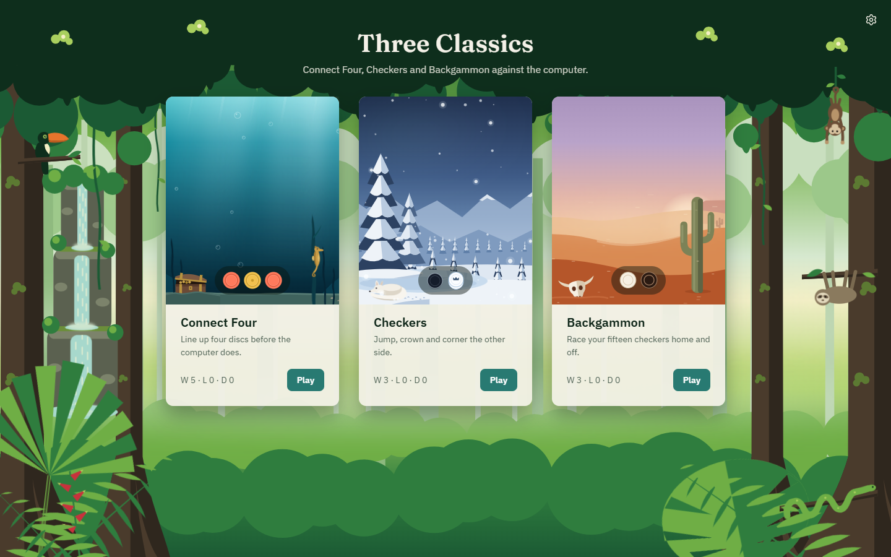
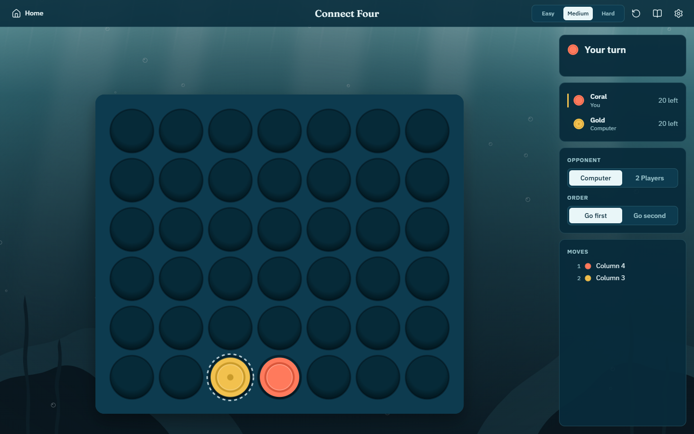
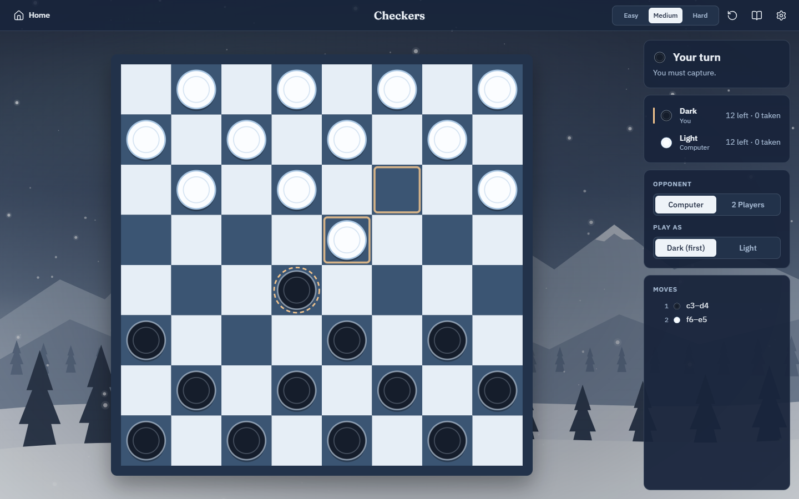
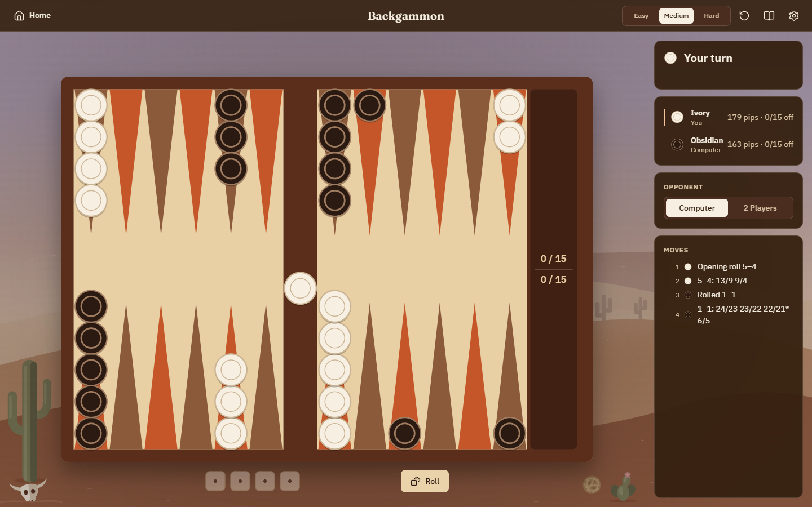
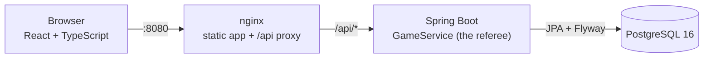
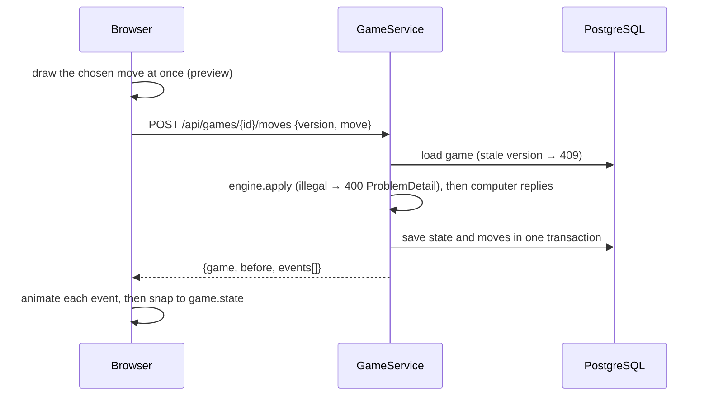

# Three Classics

Connect Four, Checkers and Backgammon, each played against the computer at three levels or by two
people on one device. Every rule and every computer move is decided by a Java server that acts as the
referee; the React client draws the board, offers only the moves the server says are legal, and
animates what happened. Each game lives in its own quiet, animated world — an ocean, a winter
evening, a desert at dusk — with a jungle home page to step out from.

| Home | Connect Four | Checkers | Backgammon |
| --- | --- | --- | --- |
|  |  |  |  |

## Quick start

Needs Docker with Compose.

```bash
docker compose up --build
```

Then open http://localhost:8080. Nothing to configure: every setting has a working default, and
`.env.example` lists the ones you can override (copy it to `.env`). The first build downloads the
Maven and npm dependencies and takes a few minutes; after that the stack starts in under a minute,
with healthchecks holding the frontend back until the backend and database are ready.

`make up` / `make down` do the same in the background (or `docker compose up --build -d --wait` and
`docker compose down`; add `-v` to `down` to wipe the database).

## What you can do

- Play against the computer on Easy, Medium or Hard, or switch to two players on one device.
- Choose to go first or second (Connect Four) or to play Dark or Light (Checkers; the board turns so
  your pieces are at the bottom). In Backgammon the opening roll decides.
- Click a piece to see where it can go; illegal clicks just shake. Multi-jumps and backgammon turns are
  built one step at a time, with Undo and Confirm for backgammon.
- Refresh at any time: the game resumes. The home page shows your record per game and offers Continue.
- Rules drawer, last-move highlights, result modal with Play again at any level, keyboard play
  throughout, and an ambient-motion switch that defaults to off under `prefers-reduced-motion`.

## Running the tests

| What | Command | Notes |
| --- | --- | --- |
| Backend unit + integration | `cd backend && ./mvnw test` | 80 tests: rules, AI, a 500-game soak per game, and API tests. API tests use Testcontainers when Docker is running, or any Postgres via `TEST_DATABASE_URL` (+ `TEST_DATABASE_USER`/`PASSWORD`). |
| Frontend unit (Vitest) | `cd frontend && npm ci && npm test` | Legal-prefix matcher, backgammon turn-graph walker, board coordinate mapping for all three boards. |
| End-to-end + layout (Playwright) | `make e2e` | Starts the compose stack with the dev profile, then runs every spec against http://localhost:8080. |
| Screenshots | `cd frontend && SCREENSHOTS=1 npx playwright test screenshots` | Rewrites `docs/screenshots/`. |

`make test` runs the backend and Vitest suites. Without `make` (for example on Windows), `make e2e` is:

```powershell
$env:SPRING_PROFILES_ACTIVE = 'dev'; docker compose up --build -d --wait
cd frontend; npm ci; npx playwright install chromium
$env:E2E_BASE_URL = 'http://localhost:8080'; npx playwright test
```

Afterwards, `Remove-Item Env:SPRING_PROFILES_ACTIVE; docker compose up -d --wait` puts the backend
back on the default profile, which hides the dev endpoint.

The Playwright suite covers, for every game: home → game → move → computer replies → restart → home;
a near-win position → result modal → Play again; resume after refresh; keyboard play; the focus trap;
reduced motion; and layout checks at 1280×720, 1440×900, 1920×1080 and 390×844 (board fully visible
and centred within 2 px, no scrollbars, identical cell sizes, cells unchanged across a move and the
reply, nothing covering the board).

To run the e2e tests without Docker, start the backend with the dev profile and the Vite dev server,
then run Playwright (it defaults to http://localhost:5173):

```bash
cd backend && ./mvnw spring-boot:run -Dspring-boot.run.profiles=dev
```

```bash
cd frontend && npm run dev
```

```bash
cd frontend && npx playwright test
```

## Kubernetes

The same stack runs on a local [kind](https://kind.sigs.k8s.io/) cluster with the Kustomize
manifests in `k8s/`: a namespace, a Postgres StatefulSet with a PVC and Secret, backend and frontend
Deployments and Services, and a ConfigMap. The backend waits for Postgres in an init container (the
Kubernetes stand-in for Compose's `depends_on`), has startup, readiness and liveness probes on
`/actuator/health`, and both Deployments pause briefly on shutdown so rollouts drop no requests.

Compose and the port-forward both use port 8080, so run `docker compose down` first (or forward a
different port).

```bash
make k8s-up
```

That creates the cluster, builds both images, loads them into kind, applies `k8s/`, waits for the
rollouts and port-forwards http://localhost:8080. Step by step:

```bash
kind create cluster --name three-classics
docker build -t three-classics-backend:local backend
docker build -t three-classics-frontend:local frontend
kind load docker-image three-classics-backend:local three-classics-frontend:local --name three-classics
kubectl apply -k k8s/
kubectl -n three-classics rollout status deployment/backend --timeout=300s
kubectl -n three-classics port-forward service/frontend 8080:80
```

kind itself is a single binary (`winget install Kubernetes.kind`, `brew install kind`, or a release
from the kind site); `kubectl` ships with Docker Desktop.

`make k8s-down` deletes the cluster.

## Architecture



**The server is the referee.** All rules and all computer play live in the Java backend. The client
never decides legality: it renders the state and the `legalMoves` the server sent, sends back the move
the player picked, and the server validates it, applies it, lets the computer reply and stores the
result. That gives one source of truth, rules that are easy to unit-test, and the same shape a real
game site uses to stop cheating.



- **One engine interface for three games.** `GameEngine<S, M>` (initial state, legal moves, apply,
  outcome) and `AiPlayer<S, M>` are implemented per game and registered as a `GameModule`.
  `GameService` is written once against them.
- **Pure engines.** States are immutable records; `apply` returns a new state. Randomness (dice, AI
  variety) comes only from an injected `RandomGenerator`: `SecureRandom` in production, seeded in tests.
- **Multi-step moves.** Checkers multi-jumps arrive as complete paths; the client accepts only clicks
  that continue a legal prefix. Backgammon turns arrive as a step graph that merges equivalent orders
  of play (doubles can be played thousands of ways), which the client walks one checker at a time.
- **Optimistic locking.** Every move names the game version it was based on, so a double click gets a
  409 instead of moving twice; JPA `@Version` backs it up.
- **API.** `POST /api/games`, `GET /api/games/{id}`, `POST /api/games/{id}/moves`, `GET /api/stats`,
  `GET /actuator/health`, and `POST /api/dev/games` (custom positions, dev and test profiles only).

## Project layout

```text
backend/                 Spring Boot (Java 21, Maven wrapper)
  src/main/java/com/threeclassics/
    api/                 REST controllers, request DTOs, ProblemDetail error handler
    core/                GameEngine, AiPlayer, GameModule, Outcome, Side, Difficulty
    connectfour/         engine, bitboard AI
    checkers/            engine, alpha-beta AI
    backgammon/          engine, turn generation, step graph, expectimax AI
    service/             GameService (the referee), views, rematch rule
    persistence/         JPA entities and repositories
  src/main/resources/db/migration/   Flyway schema
frontend/                React + TypeScript (Vite), plain CSS Modules
  src/api/               typed client and DTOs
  src/app/               router, settings, storage
  src/components/        Button, SegmentedControl, Modal, Drawer, TopBar, ConfirmDialog, Toast
  src/games/shared/      game shell, session hook, prefix matcher, result modal
  src/games/<game>/      board (one SVG), page, rules, geometry
  src/themes/            tokens, and per theme a palette and a Scene (SVG layers + one canvas)
  e2e/                   Playwright specs
k8s/                     Kustomize manifests
docs/                    DECISIONS, TIME_LOG, screenshots, reference material
```

## How the computer plays

| | Easy | Medium | Hard |
| --- | --- | --- | --- |
| **Connect Four** | Random, but takes a win or blocks one about half the time | 5-ply minimax on a window-scoring heuristic with a centre preference; picks among near-equal moves | Negamax with alpha-beta on bitboards, transposition table, centre-first ordering and iterative deepening within a 1 s budget; always takes a win or blocks a single threat; opens in the centre |
| **Checkers** | Random legal move (captures are still forced) | 4-ply minimax on material and advancement | Alpha-beta with iterative deepening and a capture extension; evaluates material, advancement, back-row guard, centre control, mobility and endgame king activity |
| **Backgammon** | Random legal turn | Best resulting position by a heuristic (pips, exposed blots, points, primes, home board, bar) | Two-ply expectimax: the top candidates scored against the opponent's best reply over all 21 rolls; plays races greedily on pip count |

Hard always answers within about a second; the tests cap it at two.

## Verification

Run on Windows 11 with Docker Desktop 29 (Compose v5) and kind 0.33:

- `docker compose up --build` from scratch: all three services healthy, the app served at
  http://localhost:8080, the backend running as a non-root user, and the dev endpoint hidden (404).
- Backend: 80 tests pass with Testcontainers starting PostgreSQL 16 in Docker.
- Playwright (27 tests, e2e and layout at four viewports) passes against the Vite dev server, the
  production bundle, the Compose stack, and the kind cluster.
- `kubectl apply -k k8s/` on kind: a cold start comes up with zero restarts.

The app was first built on the same machine before Docker was installed (against a local PostgreSQL),
so the containers and manifests were verified afterwards; the two fixes that turned up are in
[docs/DECISIONS.md](docs/DECISIONS.md).

- See [docs/DECISIONS.md](docs/DECISIONS.md) for the main decisions, trade-offs and what I'd do next,
  [docs/TIME_LOG.md](docs/TIME_LOG.md) for the time breakdown, and
  [docs/agent-transcripts/](docs/agent-transcripts/) for the AI agent transcripts.
